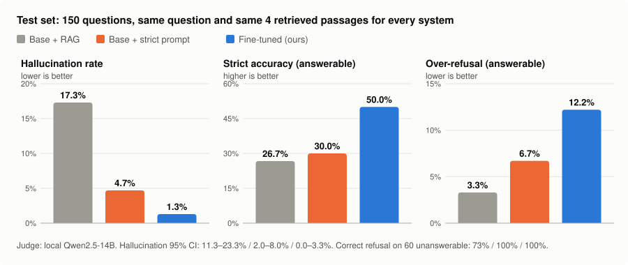
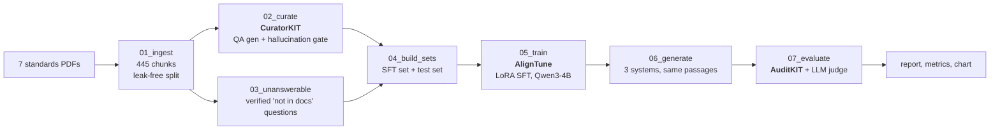
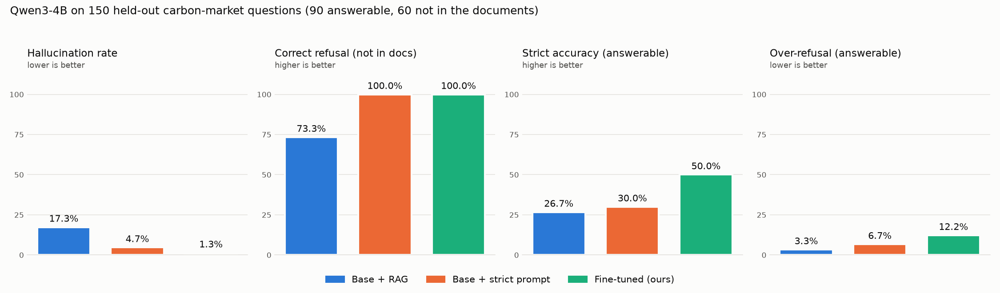
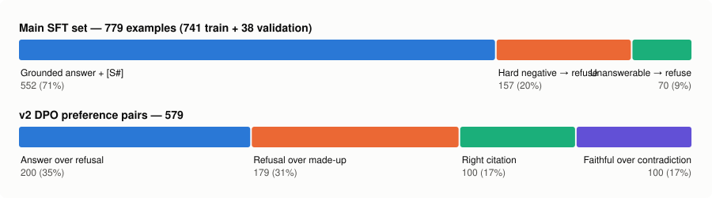
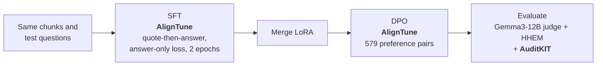
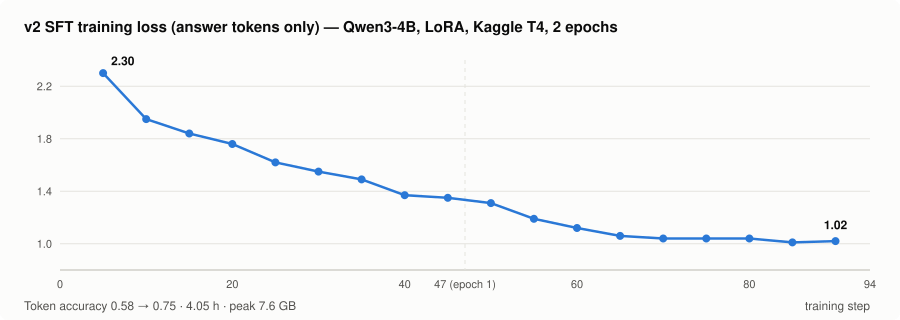
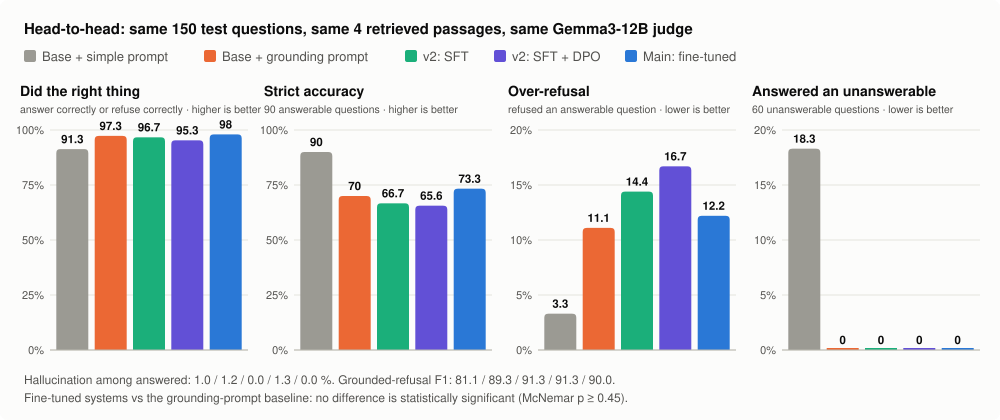

# Grounded Carbon LLM: answers only from the documents, says "Not found" otherwise

> A small open model (**Qwen3-4B-Instruct-2507**) fine-tuned to answer carbon-market compliance
> questions **only** from official standards documents. It **cites** the passage it used and replies
> **"Not found in the provided documents."** when the answer is not there.
> It is compared head-to-head against the same model with RAG and with a strict grounding prompt.

**Hackathon track:** Track 1, Fine-tuning & Data Curation (Lexsi Labs toolkits: **CuratorKIT → AlignTune → AuditKIT**)
**Problem statement:** *Grounded answers and fewer hallucinations.* Build a training set from an
organisation's own documents, train a model that answers only from them, says so when the answer is
missing, and makes measurably fewer unsupported claims.

> **Fine-tuned Qwen3-4B vs the same model with the same strict grounding prompt and the same retrieved passages:
> hallucination rate 4.7% → 1.3% (72% fewer unsupported answers), strict accuracy 30.0% → 50.0%, correct refusals 100.0%, AuditKIT F1 0.709 → 0.736. Trained in 43 min on one free T4.**
> Trade-off: over-refusal rose 6.7% → 12.2%.



## The three Lexsi Labs toolkits: where each one is used
| Stage | Toolkit | Where in the code | What it does here |
|---|---|---|---|
| **Build the data** | **CuratorKIT** | [`scripts/02_curate.py`](scripts/02_curate.py), `run_curatorkit()` | `Curator(CuratorConfig(...)).run()`: schema gate → exact + **MinHash dedup** → text cleaning → **QA generation** (3 per chunk) → **HallucinationGate** (judge model, threshold 0.7) → Alpaca export. Its `stage_counts` give the data funnel. |
| **Train** | **AlignTune** | [`scripts/05_train.py`](scripts/05_train.py) | `aligntune.create_sft_trainer(...)`: SFT with **LoRA** (r=16, α=32) on Qwen3-4B-Instruct, 4-bit, Unsloth backend, chat-template `messages` data. |
| **Evaluate** | **AuditKIT** | [`scripts/07_evaluate.py`](scripts/07_evaluate.py) | `ak.evaluate(...)` with `Hallucination` (LLM judge), `lexical_groundedness`, `context_coverage`, `f1_score` on base vs fine-tuned answers, then `ak.compare(...)`. |

---

## Table of contents
1. [Why this problem](#why-this-problem)
2. [What the model does](#what-the-model-does)
3. [The document corpus](#the-document-corpus)
4. [Pipeline overview](#pipeline-overview)
5. [Step-by-step: what each script does](#step-by-step-what-each-script-does)
6. [Key design decisions](#key-design-decisions)
7. [Evaluation: how "fewer hallucinations" is measured](#evaluation-how-fewer-hallucinations-is-measured)
8. [Tech stack](#tech-stack)
9. [Repository layout](#repository-layout)
10. [How to run](#how-to-run)
11. [Progress](#progress)
12. [Limitations](#limitations)
13. [v2: SFT → DPO, head-to-head with the main model](#v2-sft--dpo-head-to-head-with-the-main-model)

---

## Why this problem
Carbon credits are worth money only if they follow the rules of a standard: Verra VCS, Gold Standard,
ICVCM Core Carbon Principles, UNFCCC Article 6.4, or India's Carbon Credit Trading Scheme. Analysts
ask questions like *"How long is the crediting period?"* or *"What happens if a reversal exceeds the
buffer contribution?"*

General LLMs answer these **confidently and often wrongly**. They mix up standards, invent percentages,
or accept a false premise. In compliance work, a confident wrong answer is worse than no answer.
This project trains a model that:

- answers **only** from the organisation's documents,
- **cites** which retrieved passage supports each answer (`[S1]`, `[S2]` …),
- **refuses** with an exact, machine-checkable sentence when the documents don't contain the answer,
- and does this **without becoming over-cautious** (over-refusal is tracked as a first-class metric).

## What the model does
```
Question:  Under the ICVCM framework, what must a Jurisdictional REDD+ proponent do if a
           reversal exceeds its contributions to the pooled buffer reserve?
Sources:   [S1] … [S2] … [S3] … [S4] …   (top-4 passages from hybrid retrieval)

Answer:    The proponent must replenish the pooled buffer reserve so that it returns to a
           percentage proportionate to the reversal risk … [S2]

Question:  What is the CORSIA eligibility deadline for Gold Standard credits issued in 2025?
Answer:    Not found in the provided documents.
```

## The document corpus
Seven public, official documents (≈20 MB of PDFs → **445 text chunks** of ~300 words):

| Document | Publisher | Chunks (train / test / buffer) |
|---|---|---|
| VCS Standard v5.0 | Verra | 105 / 6 / 2 |
| VCS Program Guide v5.0 | Verra | 26 / 0 / 0 |
| Principles & Requirements v2.1 | Gold Standard | 39 / 6 / 2 |
| Core Carbon Principles v3 (framework + procedure) | ICVCM | 120 / 30 / 8 |
| Article 6.4 Activity Standard for Projects v2.0 | UNFCCC | 44 / 18 / 6 |
| Article 6.4 Methodology Standard (A6.4-SBM014-A05) | UNFCCC | 16 / 6 / 1 |
| Carbon Credit Trading Scheme 2023 (Gazette S.O. 2825(E)) | Govt. of India, Ministry of Power | 10 / 0 / 0 |
| **Total** | | **360 / 66 / 19** |

Exact versions and download links: [`docs/SOURCES.md`](docs/SOURCES.md). The PDFs are not committed;
download them into `data/raw/`.

## Pipeline overview


<details><summary>Detailed text version</summary>

```
 PDFs (7 standards)
   │
   ▼ 01_ingest ──────────► 445 chunks, block-level train/test split + buffer chunks (no leakage)
   │
   ├─▶ 02_curate (CuratorKIT) ──► QA generation (gpt-oss-120b)
   │                              → hallucination gate (Qwen3 27B, different model family)
   │                              → MinHash dedup → clean grounded QA pairs
   │
   ├─▶ 03_unanswerable ─────────► "not in the docs" questions, 3 kinds
   │                              (missing detail / out of scope / false premise),
   │                              each VERIFIED against real retrieval
   │
   ▼ 04_build_sets ─────────────► SFT set (chat "messages" format):
   │                                • positives: question + 4 sources → answer with [S#]
   │                                • hard negatives: SAME question, evidence removed → refusal
   │                                • unanswerables → refusal
   │                              + test_candidates.csv (keep=0 column for optional hand review)
   │
   ▼ 05_train (AlignTune) ──────► LoRA SFT on Qwen3-4B (Unsloth, 4-bit, T4 GPU on Kaggle)
   │
   ▼ 06_generate ───────────────► 3 systems answer the same test questions with the same passages
   │
   ▼ 07_evaluate (AuditKIT) ────► hallucination rate, correct refusal, over-refusal, accuracy,
                                  citation rate, retrieval recall + AuditKIT metrics → report + chart
```
</details>

## Step-by-step: what each script does

### `scripts/01_ingest.py`: PDFs → chunks
- Extracts text with `pypdf` and splits it into **300-word chunks with 50-word overlap**.
- **Quality filter:** drops chunks that are mostly numbers/tables (alphabetic share < 0.55) or non-English
  (ASCII share < 0.9). This removes the Hindi half of the Indian gazette.
- **Block-level split:** groups 6 consecutive chunks into a block and sends ~12% of blocks to *test*.
  Chunks next to a test block become **buffer** and are used by nobody. Overlapping chunks would
  otherwise leak test text into training.
- Output: `data/work/chunks.jsonl`, `data/work/ingest_stats.json`.

### `scripts/02_curate.py`: CuratorKIT: chunks → grounded QA pairs
- Samples up to 200 train chunks and 60 test chunks. Each is prefixed with `Document: <name>` so
  questions name the standard ("Under the VCS Standard, …") instead of "according to the passage".
- Runs a **CuratorKIT** pipeline:
  `JSONLReader → SchemaGate → ExactDeduplicator → MinHashDeduplicator → TextCleaner → QAGenerationTask (3 Q/chunk) → HallucinationGate (threshold 0.7) → AlpacaExporter`
- The **generator** (`openai/gpt-oss-120b`) and the **hallucination judge** (`qwen/qwen3.8-27b`) are
  different model families, so the judge doesn't share the generator's blind spots.
- Maps every QA pair back to its source chunk (normalised text match, falling back to embedding
  nearest-neighbour) so it inherits the chunk's train/test split.
- Saves the **data funnel** (how many samples survived each stage) to `data/work/funnel.json`.
- `--engine fallback` is an emergency path with plain LLM calls and the same stages. **The submitted run uses CuratorKIT.**

Sample pairs from the CuratorKIT smoke run (12 chunks → 36 pairs, 36/36 passed the gate):

| Question | Answer (truncated) |
|---|---|
| Which elements are assessed during a Design Certification Renewal according to the Gold Standard requirements? | (a) changes in the project related to the General Eligibility Criteria; (b) incorporation of relevant updates to the Gold Standard Requirements; (c) re-definition of the baseline scenario … |
| What are the three specific requirements a carbon-crediting program must satisfy before it can grant the CCP Attribute of quantified positive SDG impacts? | (1) monitor and quantify SDG impacts ex-post using a method recognised by a CCP-Eligible program; (2) demonstrate a quantified positive impact … |
| How are transition projects treated in terms of crediting cycles when they move to the Gold Standard for Global Goals? | They retain their existing crediting cycle and maximum crediting periods … |

### `scripts/03_unanswerable.py`: questions the documents do *not* answer
- From 60 random seed passages, `gpt-oss-20b` writes 4 realistic analyst questions each:
  - **missing_detail**: same topic, but asks for a fee, number, deadline or step the corpus doesn't give
  - **out_of_scope**: a neighbouring programme or jurisdiction not in the corpus (e.g. CORSIA)
  - **false_premise**: confidently assumes a rule or number that isn't stated
- **Verification:** each candidate is run through the *real* retriever (top-4, exactly as at test time).
  A judge must say the sources do **not** answer it. "yes" and "partial" are discarded.
- 40% go to test. Training questions that are near-duplicates of a test question (cosine ≥ 0.88) are removed.

### `scripts/04_build_sets.py`: training set + test set
Every training example looks exactly like inference: **system prompt + 4 retrieved sources + question**.
- **Positive:** gold passage among the sources (plus 3 retrieved distractors) → answer + `[S#]` citation.
- **Hard negative (contrastive):** the *same* question (~35% of positives) with its evidence removed and
  the other retrieved passages kept → `Not found in the provided documents.`
- **Unanswerable:** verified out-of-corpus question with its real retrieved sources → refusal.
- Only **train-split** chunks are ever used as training context (verified by a leakage test).
- A regex drops leftover "the passage / this section" questions.
- Outputs: `outputs/sft/train.jsonl`, `outputs/sft/validation.jsonl` (AlignTune-ready `messages`
  format) and **`outputs/test_candidates.csv`**, with a `keep` column for optional hand review (`keep=0` drops a row).

### `scripts/05_train.py`: AlignTune fine-tuning
- `aligntune.create_sft_trainer` on `unsloth/Qwen3-4B-Instruct-2507`
- **LoRA** r=16, α=32, dropout 0.05 · **4-bit** quantisation · fp16 · max sequence 3072 tokens
- batch 2 × grad-accum 8 (effective 16) · 2 epochs · lr 2e-4
- `--max-samples 40 --epochs 1` gives a 5-minute smoke test. `--backend trl` and `--engine trl` are fallbacks.
- The LoRA adapter is saved to `outputs/adapter/`.

### `scripts/06_generate.py`: the three systems
All three see **the same question and the same top-4 retrieved passages**:

| System | Model | Prompt |
|---|---|---|
| `base_rag` | Qwen3-4B (base) | simple "use the context" prompt |
| `base_strict` | Qwen3-4B (base) | the strict grounding prompt we train with (**strong baseline**) |
| `tuned_rag` | Qwen3-4B + our LoRA | strict grounding prompt |

The adapter is toggled on and off in one loaded model, so the base and tuned systems share identical weights.
It also records whether retrieval actually found the gold passage.

### `scripts/07_evaluate.py`: scoring (Groq judge + AuditKIT)
See [Evaluation](#evaluation-how-fewer-hallucinations-is-measured). Writes `outputs/results/metrics.json`,
`report.md` and `chart.png`.

### `app.py`: demo
A Gradio app with **base (strict prompt)** and **fine-tuned** side by side on the same question.
It shows the retrieved sources and highlights the ones each answer cites. `share=True` gives a public link.

## Key design decisions
| Decision | Why |
|---|---|
| **Contrastive hard negatives** (same question with and without evidence) | Teaches the model to check *whether the answer is in the sources*, not *whether the topic sounds familiar*. This is the core trick. |
| **Strict-prompt baseline** | Gains must come from fine-tuning, not from a better prompt. Base and tuned get the identical prompt. |
| **Exact refusal string** | `Not found in the provided documents.` can be detected automatically, so refusal metrics need no judge. |
| **Different judge family from generator** | gpt-oss writes the QA pairs and Qwen gates them, which reduces self-agreement bias. |
| **Block-level split + buffer chunks** | Overlapping chunks can't leak test passages into training. |
| **Verified unanswerables** | A "not in the docs" question is kept only if real retrieval confirms the answer isn't there. |
| **Hybrid retrieval** (BGE-small dense + BM25, reciprocal-rank fusion) | Dense finds paraphrases, BM25 finds exact terms like "VM0048" or "Article 6.2". |
| **Over-refusal tracked separately** | A model that always says "not found" would score 0% hallucination. We report over-refusal too, including only the cases where evidence *was* retrieved. |
| **Free-tier engineering** | A disk cache for every LLM call, backoff that reads Groq's "try again in Xs", and per-model task split under 1000 req/day / 8000 TPM. |

## Evaluation: how "fewer hallucinations" is measured
Test set: 150 questions built only from test-split chunks: 90 answerable (CuratorKIT QA pairs) and 60 verified *not* in the documents.

| Metric | Definition |
|---|---|
| **Hallucination rate** ↓ | % of responses with ≥1 claim not supported by the retrieved sources (LLM judge: local Qwen2.5-14B), with a **95% bootstrap CI** |
| **Correct refusal** ↑ | % of unanswerable questions answered with the refusal sentence |
| **Over-refusal** ↓ | % of answerable questions refused, also reported only where the gold passage *was* retrieved |
| **Accuracy** ↑ | answer matches the gold answer (LLM judge) |
| **Citation rate** ↑ | % of answers that cite a source `[S#]` |
| **Retrieval recall** | % of answerable questions where the gold (or neighbouring) chunk was in the top 4 |
| **AuditKIT** | `lexical_groundedness`, `context_coverage`, `f1_score` on every answer, plus `ak.compare` base vs tuned. AuditKIT's claim-level `Hallucination` judge is supported (`07_evaluate.py` without `--no-auditkit-judge`) but was skipped in the final run to fit the free GPU session. |

### Results
Test set: **150 questions** (90 answerable from held-out test chunks, 60 verified *not* in the documents), all from
chunks the model never saw in training. Every system gets the **same question and the same top-4 retrieved
passages**. Judge: local Qwen2.5-14B (an older, larger Qwen than the Qwen3-4B being tested, so the same model family; the v2 run below uses a Gemma judge to remove that bias). Retrieval recall@4: 77.8%.

| Metric | Base + RAG | Base + strict prompt + RAG | **Fine-tuned + RAG (ours)** |
|---|---|---|---|
| Hallucination rate (≥1 unsupported claim) ↓ | 17.3% | 4.7% | 1.3% |
| Correct refusal on unanswerable ↑ | 73.3% | 100.0% | 100.0% |
| Made-up answer on unanswerable ↓ | 11.7% | 0.0% | 0.0% |
| Accuracy on answerable, strict ↑ | 26.7% | 30.0% | 50.0% |
| Accuracy on answerable, incl. partial ↑ | 95.6% | 93.3% | 87.8% |
| Over-refusal on answerable ↓ | 3.3% | 6.7% | 12.2% |
| Over-refusal when evidence *was* retrieved ↓ | 0.0% | 1.4% | 4.3% |
| Answers citing a source ↑ | 6.8% | 100.0% | 97.5% |
| Hallucination 95% bootstrap CI | [11.3%, 23.3%] | [2.0%, 8.0%] | [0.0%, 3.3%] |
| AuditKIT lexical_groundedness ↑ | 0.850 | 0.831 | 0.821 |
| AuditKIT context_coverage ↑ | 0.797 | 0.797 | 0.797 |
| AuditKIT f1_score (vs gold) ↑ | 0.277 | 0.709 | 0.736 |



**What the numbers say**
- **Plain RAG is not enough.** With a simple "use the context" prompt, the base model hallucinates on 17.3% of
  questions, refuses only 73% of out-of-corpus questions, makes up an answer for 11.7% of them, and almost never cites.
- **Fewer hallucinations than the strong baseline.** The fair comparison is *Base + strict prompt*: same model, same
  prompt, same passages. The only difference is our LoRA. Hallucinated answers dropped by about 70%, and the
  confidence intervals barely overlap.
- **More exact answers.** Strict accuracy (answer fully matches the gold answer) went from 30% to 50%. The tuned model
  copies facts from the cited passage instead of paraphrasing loosely, which also lifts AuditKIT's F1.
- **AuditKIT agrees.** `ak.compare` (strict baseline → fine-tuned): F1 vs gold 0.709 → 0.736 (+3.8%), with
  **13 answers going wrong → right and 1 going right → wrong**. Lexical groundedness stays about the same (0.831 → 0.821).
- **Refusals stay perfect.** Both strict-prompt systems refused all 60 out-of-corpus questions, with zero made-up answers.
- **The cost is caution.** The tuned model refuses more answerable questions (over-refusal 6.7% → 12.2%). Where the
  evidence *was* retrieved, it refuses only 4.3%, so most refusals come from retrieval misses, not the model.
  It also gives fewer "partially correct" long answers (93% → 88% incl. partial). For compliance work, that trade
  (say less, say only what's there) is usually the right one.

All raw outputs are in the repo: [`outputs/results/`](outputs/results) (judged answers, `metrics.json`,
`report.md`, `auditkit_compare.txt`), [`outputs/preds/`](outputs/preds) (every answer, plus `tuned_rag.raw.jsonl`),
[`outputs/sft/`](outputs/sft) (the training set) and [`outputs/test_candidates.csv`](outputs/test_candidates.csv).

### Data funnel (CuratorKIT → training set)
| Stage | Count |
|---|---|
| PDF chunks (300 words, 7 documents) | 445 → 360 train / 66 test / 19 buffer |
| Seed chunks sent to CuratorKIT | 260 (200 train + 60 test) |
| QA pairs generated (`QAGenerationTask`, 3 per chunk) | 767 |
| Passed CuratorKIT `HallucinationGate` (threshold 0.7) | **757** (10 rejected) |
| After dropping non-self-contained questions ("the passage…") | 718 |
| "Not in the documents" candidates → verified against retrieval | 246 → **150** (75 missing detail, 42 out of scope, 33 false premise) |
| **SFT training examples** | **741** train + 38 validation: 552 grounded answers with citations, 157 hard negatives (same question, evidence removed → refusal), 70 unanswerable → refusal (29% refusals) |



### Training (AlignTune)
`aligntune.create_sft_trainer` with the Unsloth backend: Qwen3-4B-Instruct-2507, 4-bit, LoRA r=16/α=32 on all
attention and MLP projections (33M trainable params, 0.81%), 1 epoch, 47 steps, effective batch 16, lr 2e-4,
gradient checkpointing, max length 2560. **43 minutes on a free Colab T4.** Logged loss 2.15 → 1.59 (run average 1.76).
The loss covers the whole prompt, including the 4 source passages.

**Known issue, fixed at decoding.** The adapter learned to start answers with a stray `assistant` role header, and
21/150 answers stopped immediately. `common/model.py` now strips the header and blocks end-of-turn on the first
token. `scripts/06b_fix_empty.py` regenerated the 21 empties (1 stayed empty and is scored as a miss). The raw
outputs are kept for transparency.

## Tech stack
| Area | Tools |
|---|---|
| Data curation | **CuratorKIT** 0.1.27 (QA generation, hallucination gate, MinHash dedup, cleaning) |
| Fine-tuning | **AlignTune** (SFT + LoRA), Unsloth, TRL, PEFT, bitsandbytes (4-bit) |
| Evaluation | **AuditKIT** (hallucination, groundedness, coverage, F1), custom judge + bootstrap CIs |
| Base model | `Qwen/Qwen3-4B-Instruct-2507` |
| LLMs for data + judging | **Qwen2.5-14B served by Ollama on the GPU**, called through LiteLLM by CuratorKIT, our scripts and AuditKIT. Groq `gpt-oss-120b` was used for the laptop runs until its free daily limit ran out. |
| Retrieval | `BAAI/bge-small-en-v1.5` (sentence-transformers) + `rank_bm25`, RRF fusion |
| PDF parsing | `pypdf` |
| Compute | Laptop CPU for ingestion; **free Colab T4 GPU** (or Kaggle) for curation, training, inference and judging |
| Demo | Gradio |

## Repository layout
```
config.py               all settings (models, paths, sizes), env-overridable
common/
  llm.py                LiteLLM wrapper: disk cache, rate-limit backoff, JSON parsing, thread pool
  prompts.py            system prompts, source formatting, refusal detection, citation parsing
  retrieval.py          hybrid dense + BM25 index with RRF, embedding cache
  model.py              loads base + LoRA adapter, batched greedy generation, adapter on/off
scripts/
  01_ingest.py … 07_evaluate.py   the pipeline (see above)
kaggle/colab_run.ipynb   one-click Colab notebook: CuratorKIT data → AlignTune training → generate → AuditKIT eval → demo
kaggle/train_eval.ipynb  the same pipeline for Kaggle
app.py                  Gradio side-by-side demo
docs/SOURCES.md         exact document versions and links
requirements.txt
.env.example            GROQ_API_KEY / HF_TOKEN template
```

## How to run

### 0. Setup
```bash
git clone https://github.com/snehapal0905/grounded-carbon-llm && cd grounded-carbon-llm
python -m venv .venv && .venv/Scripts/activate        # Windows  (Linux/Mac: source .venv/bin/activate)
pip install -r requirements.txt                        # GPU-only packages are only needed on Kaggle
cp .env.example .env                                   # add GROQ_API_KEY (console.groq.com) and HF_TOKEN
```
Download the 7 PDFs listed in [`docs/SOURCES.md`](docs/SOURCES.md) into `data/raw/`.

### 1–4. Build the data (CPU is fine, about 3 h on the Groq free tier)
```bash
python scripts/01_ingest.py
python scripts/02_curate.py          # CuratorKIT
python scripts/03_unanswerable.py
python scripts/04_build_sets.py
```
Then open `outputs/test_candidates.csv`, set `keep=0` on wrong or ambiguous rows, and keep ≥75 per class.

> All LLM calls are cached in `data/work/llm_cache.jsonl`, so a re-run never pays twice. On Groq's free tier
> (1000 requests/day, 8000 tokens/min per model) the work is spread over three models.

### 5–7. Train and evaluate (Kaggle, GPU T4, Internet ON)
1. Upload this folder (with `data/work/chunks.jsonl`, `outputs/sft/` and the checked CSV) as a Kaggle Dataset.
2. Add the secrets `GROQ_API_KEY` and `HF_TOKEN`.
3. Open `kaggle/train_eval.ipynb` and **Run All**: smoke test → full training (~1 h) → generate → evaluate → zip results.

### Demo
```bash
python app.py        # prints a public gradio.live link
```

## Progress
- [x] Corpus chosen and downloaded (7 official documents, 445 chunks, leakage-safe split)
- [x] **CuratorKIT** curation: 260 chunks → 767 QA pairs → 757 passed the hallucination gate
- [x] 150 verified "not in the documents" questions
- [x] SFT set (741 examples, 29% refusals) + 150-question test set
- [x] Fine-tuning with **AlignTune** (Unsloth, LoRA, 43 min on a free T4)
- [x] Evaluation of 3 systems (grounding judge + **AuditKIT**): results table and chart above
- [ ] Hand spot-check of the test set (the unanswerables were LLM-verified against retrieval)
- [ ] Publish the LoRA adapter on Hugging Face (`outputs/adapter`, saved from the Colab run)
- [x] v2: second epoch with answer-only loss, quote-then-answer format (see [v2](#v2-sft--dpo-head-to-head-with-the-main-model))
- [x] v2: DPO with answer-over-refusal pairs, then head-to-head evaluation on the same 150 questions with a Gemma judge (see [results](#head-to-head-result))

## Engineering notes: what broke and how it was fixed
| Problem | Fix |
|---|---|
| Groq free tier: 8,000 tokens/min and **200,000 tokens/day per model**. The full pipeline needs about 2M tokens. | Every LLM call is cached on disk. The remaining work moved to a local **Qwen2.5-14B on Kaggle (Ollama)** via the same LiteLLM interface. `CACHE_FALLBACK_MODELS` reuses answers already produced by Groq, so nothing is generated twice. |
| `qwen3.8-27b` on Groq also caps output at 1,000 tokens/min. | That model was used only for short outputs (the gate), not generation. |
| The laptop (16 GB RAM) ran out of memory, and Claude Code stopped background jobs that used PyTorch alongside a browser. | Everything heavy moved to a GPU notebook, where the full **CuratorKIT** run has room to finish. |
| Kaggle GPU needs phone verification, which didn't sync in time. | The same notebook runs on **Google Colab** (free T4). It clones this repo, so nothing is uploaded by hand. |
| AlignTune's SFT default has gradient checkpointing off, so the first training run hit CUDA OOM on the 16 GB T4. | `gradient_checkpointing=True`, batch 1 × 16 accumulation, max length 2560. |
| The fine-tuned model emitted a stray `assistant` header and 21/150 empty answers. | Decoding strips the header and blocks end-of-turn on the first token. `06b_fix_empty.py` regenerated the empties (raw outputs kept). |
| A stalled HTTP connection froze the run for 30+ minutes. | Every LLM call has a timeout (`LLM_TIMEOUT`) plus retries with backoff that reads Groq's "try again in Xs". |
| Windows console crashed on Unicode (cp1252). | stdout/stderr are reconfigured to UTF-8 in `config.py`. |

## Limitations
- The judge is an LLM (Qwen2.5-14B) from the same model family as the Qwen3-4B being tested, which can bias it in the model's favour. Verdicts were not hand-audited. The v2 head-to-head re-judged the main model with Gemma3-12B (a different family) and found the same 0% hallucination, 100% correct refusal, and 12.2% over-refusal.
- The test set is LLM-built and LLM-verified, not hand-checked. 150 questions give wide-ish CIs (see table).
- Trained for 1 epoch to fit the free GPU session. The fine-tuned model over-refuses more than the baseline (12.2% vs 6.7%).
- QA pairs were generated from 260 of the 445 chunks only, to fit the compute budget.
- Retrieval recall caps answerable accuracy, so it is reported separately.
- The documents are a snapshot. Standards are revised often (VCS v5 is from Dec 2025).
- The India CCTS gazette is a third-party mirror of the official notification, English part only.

## Acknowledgements
Lexsi Labs for CuratorKIT, AlignTune and AuditKIT · Qwen team · Groq · Verra, Gold Standard, ICVCM,
UNFCCC and the Government of India for publishing their standards openly.

## v2: SFT → DPO, head-to-head with the main model

The main model's one clear weakness is **over-refusal (12.2%)**: it sometimes says "Not found" when the answer is in the sources. v2, in [`v2_karan/`](v2_karan/README.md), is a research-based follow-up aimed at that weakness and at judge bias. It is fully trained (SFT + DPO) and was evaluated **head-to-head with the main model on the same 150 test questions, with a judge from a different model family** ([results below](#head-to-head-result)).



| | Main pipeline | v2 |
|---|---|---|
| Output format | answer + [S#] | quote the supporting passage, then answer + [S#] |
| Loss | whole prompt (incl. 4 passages) | answer tokens only |
| Epochs | 1 | 2 |
| Preference stage | none | DPO (sigmoid + 0.2 × SFT loss, β 0.5) |
| Judge | Qwen2.5-14B (same family as the model) | Gemma3-12B (different family) + HHEM |
| GPU | Colab T4, 43 min | Kaggle T4, 4.05 h (SFT) + 2.3 h (DPO) |

**DPO preference pairs (579).** The largest group directly targets over-refusal:


**SFT training (Kaggle T4, [`v2_karan/results/run.log`](v2_karan/results/run.log)).** 738 examples (589 grounded, 110 hard negatives, 69 unanswerable), LoRA r=16 (33M params, 0.81%), 94 steps, peak 7.6 GB. Loss fell from 2.30 to 1.02 and token accuracy rose from 0.58 to 0.75. v2's loss covers only the answer, so it is not comparable with the main run's whole-prompt loss.



**Making it run on free GPUs.** Without bf16 on the T4, AlignTune/TRL crashed in several places. The fixes: fp16 everywhere (including TRL's DPO/SFT configs, which default to bf16), fp32 LoRA weights, TRL 1.18's fused LM head so DPO fits in 16 GB, single-GPU mode, saving TRL's trained DPO adapter rather than its frozen `ref` copy, and a resumable 3-run Kaggle notebook ([`v2_karan/kaggle/karan_v2_kaggle.ipynb`](v2_karan/kaggle/karan_v2_kaggle.ipynb)) that chains each run's output into the next.

**DPO training.** 579 pairs, 1 epoch, 37 steps, 2.3 h, peak 10.2 GB. Loss 0.84 → 0.22; reward margin (chosen vs rejected) 0 → 4.5; the model preferred the chosen answer on 100% of training pairs by the end.

### Head-to-head result

All five systems answered **the main pipeline's exact 150 test questions** (90 answerable, 60 unanswerable) from the same 4 retrieved passages. All were scored by **Gemma3-12B**, which is not a Qwen model, so the same-family bias in the main table above doesn't apply. None of these questions are in v2's training data. Full table: [`v2_karan/results/report.md`](v2_karan/results/report.md).



| Metric | Base + simple prompt | Base + grounding prompt | v2: SFT | v2: SFT + DPO | **Main: fine-tuned** |
|---|---|---|---|---|---|
| Did the right thing (answer or refuse correctly) ↑ | 91.3 | 97.3 | 96.7 | 95.3 | **98.0** |
| Grounded-refusal F1 (Trust-Score style) ↑ | 81.1 | 89.3 | **91.3** | **91.3** | 90.0 |
| Hallucination among answered ↓ | 1.0 | 1.2 | **0.0** | 1.3 | **0.0** |
| Answered an unanswerable question ↓ | 18.3 | **0.0** | **0.0** | **0.0** | **0.0** |
| Over-refusal on answerable ↓ | **3.3** | 11.1 | 14.4 | 16.7 | 12.2 |
| Accuracy on answerable (strict) ↑ | **90.0** | 70.0 | 66.7 | 65.6 | 73.3 |
| Cites the gold passage ↑ | 7.1 | 85.1 | **88.1** | 87.9 | n/a¹ |
| Supporting quote copied verbatim ↑ | – | 76.6 | **88.3** | 85.3 | – |
| Exact refusal sentence ↑ | 0.0 | **100** | **100** | **100** | **100** |

All %. ¹ Scored from its saved predictions, which lack gold-passage positions; its own evaluation reports a 97.5% citation rate.

**What this shows**
- **The main fine-tuned model is the best overall:** it does the right thing most often (98.0%), makes no hallucinations, never answers an unanswerable question, and is the most accurate of the grounded systems (73.3% strict).
- **Its results hold up under a different-family judge.** Gemma reproduces Qwen's main findings: 0% hallucination, 100% correct refusal, and 12.2% over-refusal.
- **v2 SFT ties on hallucination (0%) and leads on verifiable grounding:** the highest grounded-refusal F1 (91.3), the most gold-passage citations (88.1%), and 88.3% of its supporting quotes are verbatim, so a reader can check each answer.
- **DPO did not reduce over-refusal** (14.4% → 16.7%), even though 200 of its pairs targeted it. It learned its training pairs perfectly (reward accuracy 1.0) but this didn't carry over to the test set; the refusal-over-answer pairs probably outweighed the answer-over-refusal ones. Rebalancing the pairs would be the next step.
- **None of the fine-tuned systems is significantly different from a well-prompted base model** (McNemar p ≥ 0.45 vs base + grounding prompt). On this test set, most of the gain comes from grounding plus the exact refusal rule; fine-tuning adds a little, and makes the format and refusal string reliable without a long prompt.
- **The simple-prompt baseline is the most "accurate" because it answers everything:** it also answers 18.3% of unanswerable questions and cites the right passage only 7% of the time.

Caveats: 150 questions, an LLM judge, and no hand audit. HHEM ran out of GPU memory next to the judge, so only the Gemma judge and AuditKIT scored this run.
